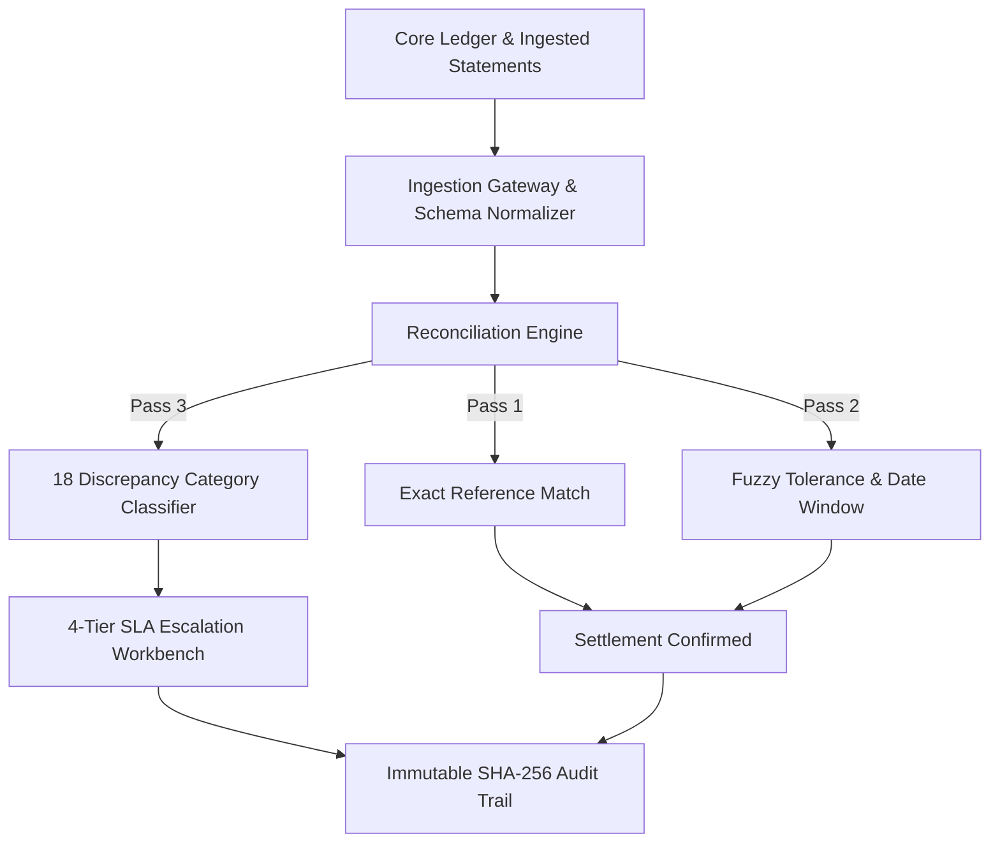

# ReconOps — Settlement Guardian

> **Automated Multi-Bank Settlement Reconciliation Engine**  
> High-performance enterprise financial operations workspace supporting 3-pass matching, multi-bank statement ingestion, 4-tier SLA exception routing, and immutable cryptographic audit trails.

---

## 🚀 Overview

**ReconOps — Settlement Guardian** is an enterprise-grade automated reconciliation platform designed for financial analysts, operations leads, and auditors. It processes intraday bank settlement feeds across international partner banks, matching core internal general ledger entries against external bank statements, identifying financial breaks, and executing automated SLA escalation workflows.

### Key Capabilities

- **3-Pass Matching Pipeline**:
  - **Pass 1 (Deterministic)**: 100% exact match on reference ID, currency, and decimal amount.
  - **Pass 2 (Fuzzy / Rule-Based)**: Windowed matching across configurable date lag (0–7 days) and currency amount tolerance thresholds.
  - **Pass 3 (Exception Categorization)**: Automated break classification into 18 discrepancy categories with financial impact calculation.
- **Multi-Bank Ingestion Gateway**:
  - Automated parser support for **Bank CSV**, **SWIFT MT940**, and **ISO 20022 CAMT.053 XML** formats.
  - Real-time header detection, column mapping versioning, and validation error accounting.
- **Exception Management Workbench**:
  - 4-Tier SLA escalation routing (`Tier 1: Rules/Fees`, `Tier 2: Analyst Workbench`, `Tier 3: Supervisor Lead`, `Tier 4: Operations Director`).
  - Justification logging and dual-control approvals.
- **Cryptographic Audit Trail**:
  - Immutable SHA-256 Merkle hash chain securing every action, override, and parameter update.
  - One-click live mathematical integrity verification against FINRA/SEC WORM criteria.
- **Performance Lab**:
  - High-throughput simulation laboratory testing parser throughput against the 100,000+ records/min specification target.
- **Role-Based Access Control (RBAC)**:
  - Granular entitlement enforcement supporting `VIEWER` (auditor read-only), `ANALYST` (operator), `ADMIN` (configuration lead), and `SYSTEM` (daemon).

---

## 🏛️ System Architecture



---

## 🛠️ Tech Stack

- **Frontend**: React 19, TypeScript, Vite, Tailwind CSS v4, Lucide Icons
- **Backend**: FastAPI, Python 3.10+, SQLAlchemy, Pydantic, Uvicorn
- **Security & Integrity**: SHA-256 Merkle Hash Chaining, RBAC

---

## ⚡ Quickstart

### Prerequisites

- Node.js 18+ and npm
- Python 3.10+

### 1. Clone & Setup

```bash
git clone https://github.com/Nithinreddy44/Project-1B-Automated-Reconciliation-Engine-Multi-Bank-Settlement.git
cd Project-1B-Automated-Reconciliation-Engine-Multi-Bank-Settlement
```

### 2. Start the Backend API

```bash
# Start FastAPI backend (port 8000)
python3 -m uvicorn backend.app.main:app --reload --port 8000
```

The API will initialize the database and seed realistic test scenarios automatically. API documentation is available at `http://localhost:8000/docs`.

### 3. Start the Web Workspace

```bash
# In another terminal window:
npm run web
```

Access the ReconOps application at **`http://localhost:3000`**.

---

## 📋 Available Commands

| Command | Description |
| :--- | :--- |
| `npm run web` | Starts the Vite development server (`http://localhost:3000`) |
| `npm run build` | Compiles TypeScript and builds production web bundle |
| `npm run lint` | Runs oxlint fast code linter across all frontend files |
| `npm run backend` | Starts the FastAPI server (`http://localhost:8000`) |

---

## 📄 License

Proprietary enterprise financial technology software. All rights reserved.
